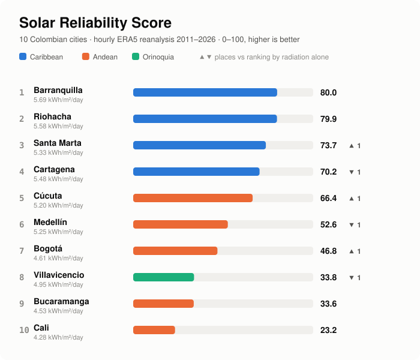
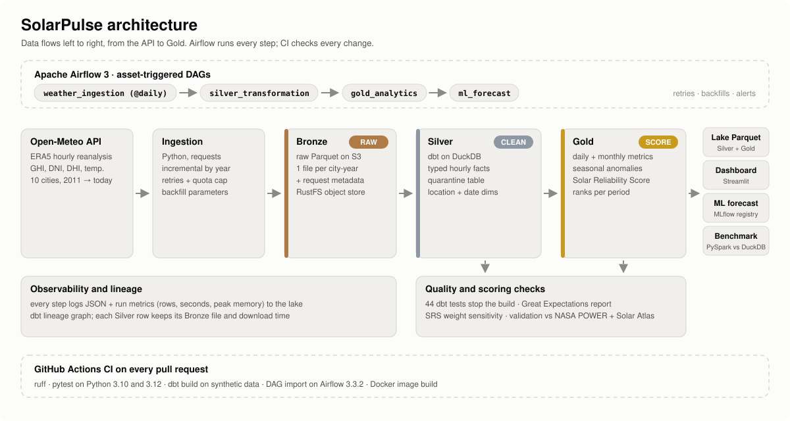

# SolarPulse


SolarPulse turns 15 years of hourly weather reanalysis from
[Open-Meteo](https://open-meteo.com/en/docs/historical-weather-api) into a **Solar
Reliability Score (SRS)** for Colombian cities. It ranks cities not only by mean solar
radiation but also by day-to-day variability, seasonality, how often low-radiation days
occur and heat stress.

It is a data engineering portfolio project built as a real system: incremental ingestion,
a Medallion lakehouse on an S3-compatible object store, dbt models with tests and
quarantine, Airflow orchestration with backfills, CI/CD, run metrics, an ML model tracked
in MLflow and a dashboard. Everything runs locally on free, open-source tools.

<picture>
  <source media="(prefers-color-scheme: dark)" srcset="docs/images/srs-ranking-dark.svg">
  
</picture>

## City Ranking

| SRS rank | City | Region | SRS (0–100) | Mean daily GHI (kWh/m²) | Rank by radiation alone |
| --- | --- | --- | --- | --- | --- |
| 1 | Barranquilla | Caribbean | 80.0 | 5.69 | 1 |
| 2 | Riohacha (La Guajira) | Caribbean | 79.9 | 5.58 | 2 |
| 3 | Santa Marta | Caribbean | 73.7 | 5.33 | 4 ▲ |
| 4 | Cartagena | Caribbean | 70.2 | 5.48 | 3 ▼ |
| 5 | Cúcuta | Andean | 66.4 | 5.20 | 6 ▲ |
| 6 | Medellín | Andean | 52.6 | 5.25 | 5 ▼ |
| 7 | Bogotá | Andean | 46.8 | 4.61 | 8 ▲ |
| 8 | Villavicencio | Orinoquia | 33.8 | 4.95 | 7 ▼ |
| 9 | Bucaramanga | Andean | 33.6 | 4.53 | 9 |
| 10 | Cali | Andean | 23.2 | 4.28 | 10 |

History 2011-01-01 to 2026-11-02, 1,388,400 valid hourly rows, 0 quarantined.

**Is the sunniest city also the most reliable?** At the top, yes: Barranquilla leads
both rankings, virtually tied with La Guajira. Below them, stability reorders the list:
Santa Marta overtakes Cartagena (lower variability and seasonality), Cúcuta overtakes
Medellín (the least seasonal of the ten), and Bogotá overtakes Villavicencio (whose rainy
season brings many low-radiation days).

**Results at a glance** (details in [docs/results.md](docs/results.md)):

- The ranking is robust to the weights (mean Spearman 0.98 over 5,000 weight sets), and
  ERA5 agrees with Global Solar Atlas about as well as two satellite products agree with
  each other.
- A next-day forecast beats the seasonal climatology by 22 % on unseen years.
- On 131 M rows, DuckDB answers in under 2 s; PySpark in local mode takes 3.5–10× longer.

> The score compares solar *conditions*. It is not an estimate of electricity production,
> which would require modeling panels, orientation and losses.

## Technology Stack

| Area | Technology | Version |
| --- | --- | --- |
| Language | Python | 3.10 (host), 3.12 (containers) |
| Ingestion | `requests`, PyArrow | requests 2.34, PyArrow 18.1 |
| Lake | RustFS, S3-compatible object store | 1.0.3 |
| Processing | DuckDB | 1.5.6 |
| Transformation | dbt-core with dbt-duckdb | 1.11.17 / 1.11.1 |
| Data quality | dbt tests, Great Expectations | GX 1.24.1 |
| Orchestration | Apache Airflow (LocalExecutor, Postgres 16) | 3.3.2 |
| ML | scikit-learn, MLflow tracking server and registry | 1.7.2 / 3.18.0 |
| Benchmark | PySpark in local mode (Java 17+) | 4.2.1 |
| Dashboard | Streamlit, Altair | 1.65.0 / 5.5.0 |
| Containers | Docker Compose | Compose v2+ |
| CI/CD | GitHub Actions | |
| Tooling | pytest, ruff | 8.4 / 0.17 |

Dependency ranges live in [requirements.txt](requirements.txt),
[dashboard/requirements.txt](dashboard/requirements.txt) and
[benchmarks/requirements.txt](benchmarks/requirements.txt). dbt-core is pinned below
1.12 because 1.12 adds a dependency without prebuilt wheels, which breaks the Docker build.

## Project Architecture

<picture>
  <source media="(prefers-color-scheme: dark)" srcset="docs/images/architecture-dark.svg">
  
</picture>

- **Bronze** keeps API responses as received, one Parquet file per (location, year),
  with the request parameters and download time.
- **Silver** holds typed, validated hourly rows. Rows that break a physical rule go to a
  quarantine table with the rules they broke.
- **Gold** holds daily and monthly solar metrics, seasonal anomalies and the SRS.
- **Publish** copies Silver and Gold from the DuckDB warehouse to the lake, so the
  dashboard and other engines read Parquet and never contend for DuckDB's single writer.
- **Airflow** chains four DAGs by data assets: `weather_ingestion` → `silver_transformation`
  → `gold_analytics` → `ml_forecast`.

More in [docs/architecture.md](docs/architecture.md) (layers, incremental loading,
lineage) and [docs/data_dictionary.md](docs/data_dictionary.md) (every table and column).

## Getting Started

### Prerequisites

- Docker with Compose v2
- Python 3.10 or newer and `make`
- Java 17 or newer, only for the benchmark

### Run everything in Docker

```bash
git clone <repository-url> solarpulse && cd solarpulse
make up        # creates .env from .env.example, builds images, starts all services
make trigger   # runs the pipeline in Airflow now (it also runs daily)
```

| Service | URL |
| --- | --- |
| Dashboard | http://localhost:8501 |
| Airflow | http://localhost:8080 |
| MLflow | http://localhost:5001 |
| Lake console (RustFS) | http://localhost:9001 |

The first run downloads 16 years for 10 cities (160 requests, about 5 minutes).

### Run the steps on the host

```bash
make install    # virtualenv in .venv with requirements.txt
make plan       # which partitions are missing, without downloading
make pipeline   # ingest → transform → quality → scoring → publish → ml
make dashboard  # Streamlit on http://localhost:8501
make help       # every target
```

### Configuration

| File | What it controls |
| --- | --- |
| [.env](.env.example) | Storage backend (`s3` or `local`), S3 credentials and endpoint, MLflow URI, alert webhook |
| [config/settings.yml](config/settings.yml) | API variables and weather model, retries, history start, active locations, quota cap |
| [config/locations.yml](config/locations.yml) | The 10 cities: coordinates, region, elevation |
| [dbt/dbt_project.yml](dbt/dbt_project.yml) | Quality thresholds, indicator thresholds, SRS weights |

Without Docker, set `SOLARPULSE_STORAGE_BACKEND=local` in `.env`: everything writes to
`data/lake/`, and `make sample` fills it with synthetic data.

## Reproduce the Results

Anyone can rebuild the ranking above from scratch: every input is public and free, and
no account or API key is needed.

### What you need

| Resource | Minimum |
| --- | --- |
| Docker memory | 6 GB (8 GB recommended): Airflow, Postgres, MLflow, the lake and the dashboard |
| Disk | About 6 GB for images and data (plus 2.5 GB for the optional benchmark) |
| Free ports | 8080, 8501, 5001, 9000, 9001 |
| Network | Access to `archive-api.open-meteo.com` |
| Time | About 15 minutes the first time (image build ~10 min, download ~5 min) |

### Step by step

1. **Freeze the date range** so your numbers match the ones published here. In
   [config/settings.yml](config/settings.yml) set:

   ```yaml
   ingestion:
     end_date: "2026-11-02"
   ```

   Leave it empty to follow the archive up to today minus 7 days instead.

2. **Start the environment and run the pipeline:**

   ```bash
   git clone <repository-url> solarpulse && cd solarpulse
   make up
   make trigger
   ```

3. **Watch it run** at http://localhost:8080. Four DAGs run in sequence:
   `weather_ingestion` → `silver_transformation` → `gold_analytics` → `ml_forecast`.
   All four should end green within about 10 minutes.

4. **Check the results** at http://localhost:8501 or from the command line:

   ```bash
   make install   # host virtualenv, once
   make inspect   # Bronze rows per city and year, plus a duplicate check
   make figures   # redraws the images in docs/images from your Gold tables
   ```

### What you should see

| Check | Expected value |
| --- | --- |
| Bronze and Silver hourly rows | 1,388,400 (10 cities × 138,840 hours) |
| Quarantined rows | 0 |
| Duplicate `(location, hour)` rows | 0 |
| dbt build | 55 nodes pass (11 models, 44 tests) |
| Great Expectations report | `PASS` in `reports/data_quality_report.md` |
| SRS leader | Barranquilla 80.0, Riohacha 79.9 |
| Forecast skill vs climatology | about +22 % on 2024–2026 |

Small differences in the last decimal are possible: ERA5 publishes a preliminary version
for the most recent months and revises it later. Rankings, row counts and quality checks
should match exactly.

### Reproduce other parts

| What | Command | Notes |
| --- | --- | --- |
| Unit and end-to-end tests | `make test` | No network or Docker; about 20 seconds |
| External validation references | `python -m src.scoring.fetch_reference` | Results are already committed in [config/external_reference.csv](config/external_reference.csv) |
| PySpark vs DuckDB benchmark | `make benchmark` | Needs Java 17+; timings depend on your machine |
| National grid plan | `make grid-plan GRID=1.0` | Prints how many partitions and API calls a grid needs |

### Troubleshooting

- **A port is already in use:** stop the other service or change the left-hand port in
  [docker-compose.yml](docker-compose.yml).
- **A task fails with HTTP 429:** the free API quota was hit. The task retries with
  backoff; if it still fails, trigger it again later. Downloaded years are kept.
- **Airflow tasks fail with a DuckDB lock error:** a process on the host has the
  warehouse open (for example a notebook). Close it; tasks retry automatically.
- **Start over:** `make down`, then `docker volume rm solarpulse_lake_data` and
  `rm -rf data/` to delete every downloaded and derived file.

## Project Structure

```
solarpulse/
├── airflow/dags/          # 4 DAGs chained by data assets, shared settings and alerts
├── benchmarks/            # synthetic grid data, PySpark vs DuckDB runner, results
├── config/                # locations, settings, external reference values
├── dashboard/             # Streamlit app that reads the published lake
├── dbt/
│   ├── models/            # staging → intermediate → marts/silver → marts/gold
│   ├── macros/            # partition-level incremental loads, quality rules, generic tests
│   └── tests/             # singular tests: coverage, closure, SRS weights
├── docker/                # Airflow and dashboard images
├── docs/                  # architecture, data dictionary, methodology, results
├── src/
│   ├── common/            # config, storage, JSON logs, run metrics
│   ├── ingestion/         # API client, retries, incremental loader, grid, synthetic data
│   ├── transform/         # dbt runner
│   ├── quality/           # Great Expectations suites and report
│   ├── scoring/           # SRS in Python, sensitivity, external validation
│   ├── ml/                # next-day forecast with MLflow
│   └── lake/              # publish Silver and Gold to the lake
├── tests/                 # unit, end-to-end (dbt on synthetic data), ML leakage, DAGs
├── docker-compose.yml
└── Makefile
```

## Key Features

- **Incremental, idempotent ingestion:** the planner reads only Parquet footers to find
  missing or incomplete years; reruns call no API and backfills never duplicate rows.
- **Quota-aware loading:** retries with exponential backoff and `Retry-After`, throttling,
  and a per-run partition cap so a national grid loads in daily batches.
- **Partition-level incremental dbt models:** Silver reprocesses only the Bronze partitions
  downloaded since its last run; Gold recomputes only the affected days.
- **Quarantine, not delete:** invalid rows are kept with the list of rules they broke.
- **Two layers of data quality:** 44 dbt tests that stop the build, plus Great Expectations
  suites with a Markdown/JSON report kept in the lake.
- **Lineage:** the dbt graph runs from Gold back to Bronze, and every Silver row carries
  its Bronze file, partition and download time.
- **Solar Reliability Score** with a weight sensitivity analysis and validation against
  NASA POWER and Global Solar Atlas.
- **Seasonal anomaly detection** and a **next-day forecast** tracked and registered in MLflow.
- **Observability:** every step records status, duration, peak memory and its own counts,
  keyed by the Airflow run ID; the dashboard's *Pipeline health* tab reads them.
- **National grid and benchmark:** PySpark vs DuckDB up to 131 M rows, with the answer to
  "when does one machine stop being enough?"
- **One-command environment** and **CI on every pull request**.

## Development Workflow

1. Branch from `main`; `main` should always pass CI.
2. Make the change and run `make lint` and `make test` locally.
3. For dbt changes, run `make transform` and check the lineage with `make docs`.
4. Commit with [Conventional Commits](https://www.conventionalcommits.org/)
   (`feat(transform): ...`, `fix(ci): ...`), as in the existing history.
5. Open a pull request. [CI](.github/workflows/ci.yml) runs:
   - ruff and pytest on Python 3.10 and 3.12
   - a full dbt build, quality report, scoring and publish on synthetic data, with the
     report and dbt docs uploaded as artifacts
   - an import check of every DAG against Airflow 3.3.2
   - `docker compose config` and a build of both images

In Airflow, `weather_ingestion` runs daily and the other DAGs follow when their input
asset changes. Backfills: `make backfill YEARS="2015 2016"`.

## Coding Standards

- **English everywhere:** code, comments, log events, docs.
- **Python:** type hints and `from __future__ import annotations`; ruff with rules
  `E, F, I, UP, B` and a 100-character line limit ([pyproject.toml](pyproject.toml)).
- **Configuration, not constants:** paths, credentials and thresholds come from
  `config/`, `.env` or dbt vars. Credentials never live in YAML.
- **Logs are structured JSON**, one event per line, with fields passed as `extra`.
- **Every write is idempotent:** whole partitions are replaced (atomic temp file and
  rename), never appended.
- **dbt:** `staging` renames and types, `intermediate` prepares, `marts/silver` and
  `marts/gold` publish. Every model has a YAML entry with descriptions and tests. The
  project uses no external dbt packages; generic tests live in `dbt/macros/tests.sql`.
- **Airflow DAGs only orchestrate:** each task runs `python -m src...` in the pipeline's
  own virtualenv, and every task that touches DuckDB uses the `duckdb_warehouse` pool.

## Testing

| Suite | What it checks |
| --- | --- |
| [test_ingestion.py](tests/test_ingestion.py) | Planning, idempotency, backfills, retries, grid, quota batching (fake API client) |
| [test_transformations.py](tests/test_transformations.py) | End to end: synthetic Bronze with planted bad rows → dbt build → quarantine, Gold, rebuild, backfill, publish; Python SRS equals dbt |
| [test_data_quality.py](tests/test_data_quality.py) | Great Expectations suites pass clean data and catch broken data |
| [test_ml.py](tests/test_ml.py) | Forecast features never use the target day or later years |
| [test_dags.py](tests/test_dags.py) | DAGs import, task order, pools, retries and alerts (skipped without Airflow) |

```bash
make test        # 36 tests in about 20 s, no network or Docker
make transform   # dbt models plus 44 data tests on real data
make quality     # Great Expectations report in reports/
```

The pytest suites never call external services: a deterministic synthetic client
stands in for the Open-Meteo API.

## Contributing

1. Read [docs/architecture.md](docs/architecture.md) and
   [docs/methodology.md](docs/methodology.md) first.
2. Follow the existing patterns:
   - new data source → [incremental_loader.py](src/ingestion/incremental_loader.py)
     (plan partitions, write atomically, record run metrics)
   - new Gold model → [daily_solar_metrics.sql](dbt/models/marts/gold/daily_solar_metrics.sql)
     and its entry in [_gold.yml](dbt/models/marts/gold/_gold.yml)
   - new pipeline step → `tracked_run` from [run_metrics.py](src/common/run_metrics.py)
     and a task in [gold_analytics.py](airflow/dags/gold_analytics.py)
   - new test → the synthetic end-to-end fixture in
     [test_transformations.py](tests/test_transformations.py)
3. Changing the SRS weights or thresholds? Run `make scoring` and report how the ranking
   moved.
4. Open a pull request following the [development workflow](#development-workflow).

## License

Released under the [MIT License](LICENSE).

Data sources keep their own terms: Open-Meteo data is free for non-commercial use, and
Global Solar Atlas values are CC BY 4.0 ("Global Solar Atlas 2.0, Solargis").
